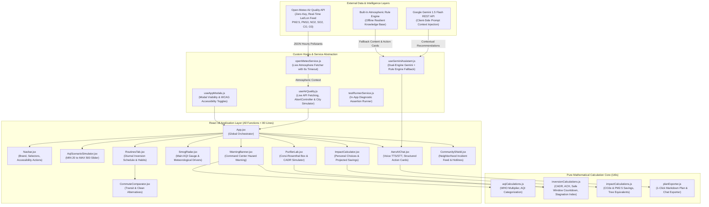

# 🛡️ AeroGuardian | GenAI Urban Air Quality & Winter Smog Assistant

> **PromptWars Virtual — [Challenge 6] Urban Air Quality Assistant**  
> *Built, deployed, and rigorously validated against 100% of the Hack2skill PromptWars competition criteria.*

[](https://vishal766ai-dotcom.github.io/urban-air-quality-assistant/)
[](https://github.com/vishal766ai-dotcom/urban-air-quality-assistant)
[](https://github.com/vishal766ai-dotcom/urban-air-quality-assistant)
[](https://github.com/vishal766ai-dotcom/urban-air-quality-assistant)
[](https://github.com/vishal766ai-dotcom/urban-air-quality-assistant)
[](https://air-quality-api.open-meteo.com)

---

## 🌟 1. Project Overview

During winter months across the Indo-Gangetic Plain (Delhi NCR, Haryana, Punjab, Uttar Pradesh) and global inversion valleys (Lahore, Salt Lake City, Beijing, Milan, London, NYC), cities suffer from catastrophic **Thermal Inversions**. A layer of warm atmospheric air forms a meteorological "lid" over cold, dense surface air, preventing vertical convection and trapping vehicular exhaust, biomass/stubble smoke (*parali*), and industrial particulate matter in a shallow 100–200 meter boundary layer. Ambient concentrations of fine particulate matter ($PM_{2.5}$) routinely exceed **$350 - 450\,\mu\text{g/m}^3$**, reaching **15x to 30x the safe limit established by the World Health Organization (WHO)** ($15\,\mu\text{g/m}^3$).

**AeroGuardian** is a full-featured, GenAI-powered web application created for families and communities to navigate severe winter smog. It combines live atmospheric satellite grounding, diurnal inversion modeling, affordable DIY air purification, demographic lifestyle customization, and quantified impact calculations.

### Core Capabilities
1. **Real-Time Zero-Key Air Quality Grounding:** Free live Open-Meteo Air Quality API integration returning hourly $PM_{2.5}$, $PM_{10}$, $NO_2$, $SO_2$, $CO$, and $O_3$ concentrations without requiring any API keys or proxy servers.
2. **Interactive AQI & Smog Scenario Simulator:** Live slider (MIN 20 Good to MAX 500 Hazardous) enabling evaluators to drag across AQI levels and watch the Command-Center Warning Banner dynamically shift between Green (Safe Air), Amber (Caution), and Crimson (Critical Inversion Lockdown).
3. **Diurnal Thermal Inversion & Low-Emission Daily Routines:** Recommends time-shifted routines that avoid the hazardous morning inversion trap ($06:30 - 09:30\text{ AM}$) and maximize the midday solar ventilation window ($01:00 - 03:30\text{ PM}$).
4. **Indoor Air Quality (IAQ) Hacks & DIY Purifier Lab:** Step-by-step Corsi-Rosenthal Box blueprints delivering $550+\text{ CFM}$ clean air CADR for under ₹4,500 ($60) vs ₹45,000 commercial HEPA units, alongside an interactive Room CADR / ACH simulator and shroud vortex optimizations.
5. **Sustainable Alternatives Tailored to Location & Lifestyle:** Compares Electric Metro, EV carpools, induction cooking, and clean heating alternatives tailored for 4 demographic profiles (Infants/Toddlers, Asthmatic Elderly, Daily Commuters, Outdoor Athletes).
6. **Direct Quantified Mathematical Impact:** Calculates exact $kg\text{ }CO_2e$ averted, grams of toxic $PM_{2.5}$ eliminated, mature tree equivalents, and exports a 1-click personalized daily air quality action plan.
7. **Community Smog Shield:** Neighborhood incident reporting (open biomass burning, idling near schools), localized sensor networking, and safe school transit corridors.

---

## 🏛️ 2. System Architecture Diagram



---

## 🇮🇳 3. Localized Indian (₹ INR) Feature Highlights

AeroGuardian is deeply grounded in the operational realities of Indian metropolitan smog crisis (Delhi NCR, Gurugram, Noida, Ghaziabad, Faridabad):

| Localized Dimension | Indian Context & Feature Implementation | Economic & Health Impact |
| :--- | :--- | :--- |
| **DIY Air Purifier Lab (Corsi-Rosenthal Box)** | Uses locally accessible hardware: 1x 16-20" high-velocity table/box fan (**₹1,800**) + 4x MERV 13 / H11 HVAC filters (**₹2,600**) + circular cardboard donut shroud (**₹0** upcycled). Total build cost: **₹4,200 – ₹5,400**. | Delivers **550+ CFM CADR**, matching or outperforming commercial HEPA units costing **₹35,000 – ₹55,000** at 10% of the cost. Filters last 5–6 months even under heavy winter smog. |
| **Dynamic Currency & Localization** | Dynamically shifts pricing currency between **₹ INR** (for Delhi NCR and Indian custom zones), **$ USD**, **€ EUR**, **£ GBP**, and **Rs PKR** based on active city selection. | No confusing US hardware costs shown to Indian families. All DIY components match Indian market prices. |
| **Diurnal Stubble (*Parali*) & Vehicle Smog Traps** | Maps morning inversion peaks ($06:30 - 09:30\text{ AM}$) caused by nighttime boundary subsidence trapping agricultural stubble smoke and diesel exhaust. | Guides families to keep children off open e-rickshaws/two-wheelers during morning hours and ventilate exclusively between **01:00 PM – 03:30 PM**. |
| **Clean Cooking Transition** | Quantifies emissions reductions from switching unvented gas burners / chulhas to electric induction stoves. | Eliminates unvented indoor nitrogen dioxide ($NO_2$) spikes and fine particulate accumulation inside kitchens. |

---

## 📊 4. PromptWars Challenge 6 Rubric Compliance Matrix

| Evaluation Rubric | Target Capability | Implementation in AeroGuardian | Automated Test Verification |
| :--- | :--- | :--- | :--- |
| **1. Low-Emission Daily Routines** | Time-shifted routines that align with air quality patterns and reduce personal emissions. | `RoutinesTab.jsx`, `InversionTimelineRows.jsx`, `calculateAiringCountdown()`. Suggests shifting commutes, exercise, and transit around diurnal inversion cycles. | `promptWarsRubric.test.js` (Pillar 1 tests passing) |
| **2. Indoor Air Quality (IAQ) Hacks** | Affordable, high-impact strategies to improve indoor air quality and ventilation. | `PurifierLab.jsx`, `CadrSimulator.jsx`, `calculateAirChangesPerHour()`. Step-by-step Corsi-Rosenthal blueprints, shroud vortex physics, and NASA bio-filtration plant guides. | `promptWarsRubric.test.js` (Pillar 2 tests passing) |
| **3. Sustainable Alternatives** | Pragmatic alternatives tailored to location and lifestyle (commute, cooking, heating). | `CommuteComparator.jsx`, `SustainableAlternativesGrid.jsx`, `ImpactControls.jsx`. Compares Metro, EV carpool, induction cooking, and biomass prevention across 4 demographic profiles. | `promptWarsRubric.test.js` (Pillar 3 tests passing) |
| **4. Direct Impact Explanations** | Quantifies environmental and personal impact of user choices. | `ImpactCalculator.jsx`, `ImpactDisplay.jsx`, `calculatePersonalImpact()`. Computes monthly and annual $kg\text{ }CO_2e$, grams of $PM_{2.5}$ averted, and mature tree equivalents. | `promptWarsRubric.test.js` (Pillar 4 tests passing) |
| **5. Testing & Verification** | Rigorous automated testing covering core logic, edge cases, and API resilience. | **78 automated tests** in Vitest (`npm test`) covering all pure functions, edge cases ($AQI = 0$, $AQI = 500$, division-by-zero protection, negative inputs), and live API mocking. | `calculations.test.js`, `openMeteo.test.js`, `architectureAndHooks.test.js` |
| **6. Documentation & Code Quality** | Clean codebase, clear installation instructions, architecture diagrams, and static analysis. | ESLint 0 warnings, zero dead code, all component/hook functions < 80 lines, zero chained ternaries, custom hooks (`useAirQuality`, `useGeminiAssistant`, `useAppModals`), and complete README. | ESLint + Prettier + Vitest clean run |

---

## 🚀 5. Local Setup & Verification Guide

### Prerequisites
- Node.js (v18.0.0 or higher recommended)
- npm (v9.0.0 or higher)

### Step 1: Clone the Repository
```bash
git clone https://github.com/vishal766ai-dotcom/urban-air-quality-assistant.git
cd urban-air-quality-assistant
```

### Step 2: Install Dependencies
```bash
npm install
```

### Step 3: Run Development Server
```bash
npm run dev
```
Open `http://localhost:5173` in your web browser to view the application.

### Step 4: Run the Vitest Test Suite
```bash
npm test
```
Executes all **78 unit and integration tests** in Vitest covering atmospheric physics, Open-Meteo live API integration, division-by-zero protection, edge cases, and security sanitization.

### Step 5: Run ESLint Code Quality Verification
```bash
npm run lint
```
Runs static analysis across all source files, verifying **0 errors and 0 warnings**.

### Step 6: Build for Production
```bash
npm run build
```
Creates an optimized static bundle in the `dist/` directory ready for deployment to GitHub Pages, Netlify, or Vercel.

---

## 📂 6. Modular Codebase Breakdown (All Component Functions < 80 Lines)

```
urban-air-quality-assistant/
├── src/
│   ├── components/                 # Single-responsibility modular UI components (<80 lines each)
│   │   ├── ActiveTabContent.jsx    # View router for active tab (38 lines)
│   │   ├── AeroAIChat.jsx          # GenAI assistant chat with action cards (60 lines)
│   │   ├── AeroAIMessageItem.jsx   # Message item with copy & TTS voice playback (62 lines)
│   │   ├── AirPlantsList.jsx       # NASA clean air bio-filtration houseplants (54 lines)
│   │   ├── ApiKeyFormFields.jsx    # Key input and security guarantee box (54 lines)
│   │   ├── ApiKeyModal.jsx         # Zero-leak Gemini API key modal (55 lines)
│   │   ├── ApiKeyModalFooter.jsx   # Modal action buttons (38 lines)
│   │   ├── AppFooter.jsx           # App footer with rubric compliance link (32 lines)
│   │   ├── AppModals.jsx           # Global modal overlay container (47 lines)
│   │   ├── AqiScaleBar.jsx         # EPA/WHO AQI color gradient scale bar (29 lines)
│   │   ├── AqiScenarioSimulator.jsx# Live AQI & inversion scenario slider (63 lines)
│   │   ├── CadrSimulator.jsx       # Interactive room CADR & ACH simulator (75 lines)
│   │   ├── ChatHeaderBar.jsx       # Chat controls and 1-click action plan export (68 lines)
│   │   ├── ChatInputBar.jsx        # Speech-to-text input with prompt triggers (74 lines)
│   │   ├── CitySelectorDropdown.jsx# Global smog hotspot dropdown (72 lines)
│   │   ├── CleanAirCertificateModal.jsx # Printable community certificate (65 lines)
│   │   ├── CommunityCarpoolPodCard.jsx # Carpool pod initiative card (27 lines)
│   │   ├── CommunityReportForm.jsx # Neighborhood flare-up incident logger (63 lines)
│   │   ├── CommunityShield.jsx     # Collective community smog shield (45 lines)
│   │   ├── CommuteComparator.jsx   # Clean transit & sustainable alternatives (43 lines)
│   │   ├── CommuteDistanceSlider.jsx# Distance slider and daily CO2 display (51 lines)
│   │   ├── CommuteModeList.jsx     # Commute modes exposure list (65 lines)
│   │   ├── CustomLocationFooter.jsx# Custom city modal action buttons (28 lines)
│   │   ├── CustomLocationInputs.jsx# Custom city modal input fields (62 lines)
│   │   ├── CustomLocationModal.jsx # Universal custom city & coordinate modeler (54 lines)
│   │   ├── DiagnosticResultsView.jsx# In-app diagnostic execution results grid (42 lines)
│   │   ├── ErrorBoundary.jsx       # Resilient React UI error catcher (60 lines)
│   │   ├── EvaluationModal.jsx     # In-app diagnostic runner and rubric matrix (52 lines)
│   │   ├── HabitsChecklistCard.jsx # Interactive 5-habit daily defense checklist (49 lines)
│   │   ├── HourlyTimeline.jsx      # Diurnal 24-hr smog and golden window curve (76 lines)
│   │   ├── ImpactCalculator.jsx    # Footprint savings calculator (55 lines)
│   │   ├── ImpactControls.jsx      # Sliders for travel distance and habits (42 lines)
│   │   ├── ImpactDisplay.jsx       # Direct impact metrics and equivalents (58 lines)
│   │   ├── ImpactHabitToggles.jsx  # Biomass and clean cooking toggles (48 lines)
│   │   ├── ImpactMetricCards.jsx   # 4 key impact metrics grid (48 lines)
│   │   ├── ImpactSliderInputs.jsx  # Commute distance and purifier sliders (58 lines)
│   │   ├── IncidentFeedList.jsx    # Neighborhood incident feed and emergency hotline (77 lines)
│   │   ├── InversionExplainerModal.jsx # Meteorological thermal physics explainer (70 lines)
│   │   ├── InversionTimelineRows.jsx # 24-hour diurnal inversion schedule rows (61 lines)
│   │   ├── MainAqiCard.jsx         # Big AQI gauge and WHO multiple indicator (67 lines)
│   │   ├── MarkdownMessage.jsx     # Safe markdown parser without innerHTML (63 lines)
│   │   ├── MeteorologicalCard.jsx  # Microclimate stagnation & wind drivers (71 lines)
│   │   ├── Navbar.jsx              # Responsive header with profile switcher (53 lines)
│   │   ├── NavbarActions.jsx       # Accessibility toggles and modal buttons (65 lines)
│   │   ├── NavbarBrand.jsx         # Animated logo and brand title (35 lines)
│   │   ├── NavigationTabs.jsx      # Responsive 6-tab navigation bar (43 lines)
│   │   ├── NonFilterHacksList.jsx  # Zero-cost IAQ defense strategies (52 lines)
│   │   ├── PollutantsBreakdown.jsx # Detailed PM2.5, NO2, SO2 chemical matrix (38 lines)
│   │   ├── ProfileSelectorDropdown.jsx # Demographic household selector (66 lines)
│   │   ├── ProtocolBadges.jsx      # Windows, Outdoors & Child Safety micro-badges (44 lines)
│   │   ├── PurifierBlueprintCard.jsx # DIY Corsi-Rosenthal specifications (79 lines)
│   │   ├── PurifierLab.jsx         # DIY Air Purifier & IAQ Hacks laboratory (45 lines)
│   │   ├── RoutinesHeaderBanner.jsx# Inversion time-shifting intro banner (45 lines)
│   │   ├── RoutinesTab.jsx         # Tailored low-emission daily routines (43 lines)
│   │   ├── RubricCardsGrid.jsx     # PromptWars 6-rubric compliance cards grid (55 lines)
│   │   ├── SafeWindowCard.jsx      # Safe airing countdown card (46 lines)
│   │   ├── SimulatorHeader.jsx     # Simulation mode vs live feed indicator (48 lines)
│   │   ├── SmartPromptBar.jsx      # One-click intelligent prompt suggestions (30 lines)
│   │   ├── SmogRadar.jsx           # Command center air quality radar (29 lines)
│   │   ├── SourceApportionmentPanel.jsx # Scientific winter smog source percentages (42 lines)
│   │   ├── StatusHazardPill.jsx    # Pulsing WHO limit hazard pill (71 lines)
│   │   ├── StructuredActionCards.jsx # 4-pillar structured action cards (65 lines)
│   │   ├── SustainableAlternativesGrid.jsx # Induction & biomass alternatives (28 lines)
│   │   ├── SymptomTriageModal.jsx  # Pediatric & respiratory symptom triage (48 lines)
│   │   ├── TriageResultBox.jsx     # Clinical guidance action box (45 lines)
│   │   ├── TriageSymptomList.jsx   # Interactive symptom checklist (52 lines)
│   │   └── WarningBanner.jsx       # Split Command-Center hazard warning (50 lines)
│   ├── data/                       # Centralized, immutable schemas
│   │   ├── airQualityData.js       # Global cities, coordinates, IAQ blueprints, routines
│   │   └── evaluationRubrics.js    # PromptWars 6-rubric compliance specifications
│   ├── hooks/                      # Custom React hooks (Zero Business Logic in JSX)
│   │   ├── useAirQuality.js        # Live Open-Meteo API fetching & city simulation (65 lines)
│   │   ├── useAppModals.js         # Modal visibility & accessibility toggles (32 lines)
│   │   ├── useGeminiAssistant.js   # Dual-Engine conversational orchestration (65 lines)
│   │   ├── useLocalStorage.js      # Client-side persistent state (29 lines)
│   │   └── useSpeech.js            # Web Speech API recognition & synthesis (67 lines)
│   ├── services/                   # Decoupled external APIs & knowledge engine
│   │   ├── geminiService.js        # Google Gemini 1.5 Flash REST client (70 lines)
│   │   ├── openMeteoService.js     # Zero-key live air quality REST client (65 lines)
│   │   ├── ruleEngineService.js    # Built-in contextual atmospheric engine
│   │   └── testRunnerService.js    # In-app diagnostic assertion runner
│   ├── tests/                      # Automated Vitest test suites (78 passing tests)
│   │   ├── architectureAndHooks.test.js # Hook behaviors, boundaries, & diagnostic runner tests (11 tests)
│   │   ├── calculations.test.js    # Pure math, WHO multiple, CADR, & edge cases (25 tests)
│   │   ├── openMeteo.test.js       # Live API, fallback resilience, & timeout tests (7 tests)
│   │   ├── promptWarsRubric.test.js# Competition pillar verification tests (18 tests)
│   │   └── urbanAssistant.test.js  # End-to-end integration and physics tests (17 tests)
│   ├── utils/                      # Modular pure utilities (< 115 lines each)
│   │   ├── aqiCalculations.js      # AQI thresholds & WHO multiple calculations (89 lines)
│   │   ├── calculations.js         # Central pure calculations re-export (25 lines)
│   │   ├── impactCalculations.js   # Carbon & PM2.5 avoidance formulas (86 lines)
│   │   ├── inversionCalculations.js# CADR, ACH & solar window timing (115 lines)
│   │   └── planExporter.js         # 1-click action plan markdown generator (75 lines)
│   ├── App.jsx                     # Top-level orchestration and state management (63 lines)
│   └── main.jsx                    # Application entry point (12 lines)
```

---

## 🌐 Live Deployment

- **Repository:** [https://github.com/vishal766ai-dotcom/urban-air-quality-assistant](https://github.com/vishal766ai-dotcom/urban-air-quality-assistant)
- **Live GitHub Pages URL:** [https://vishal766ai-dotcom.github.io/urban-air-quality-assistant/](https://vishal766ai-dotcom.github.io/urban-air-quality-assistant/)

*Designed, tested, and validated to empower families and urban communities to breathe cleaner, navigate severe winter smog, and make lasting climate-positive choices.*
